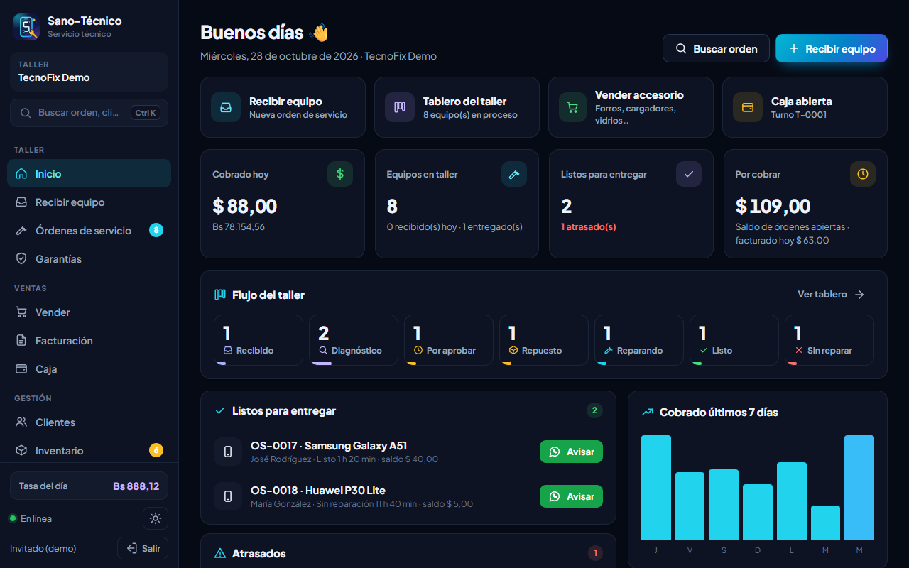
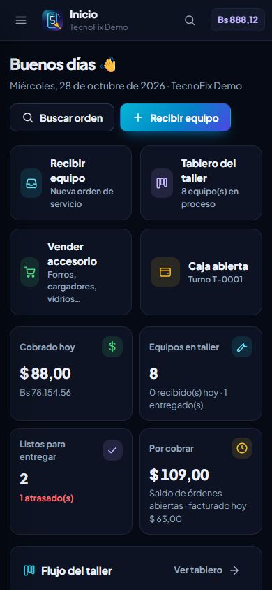
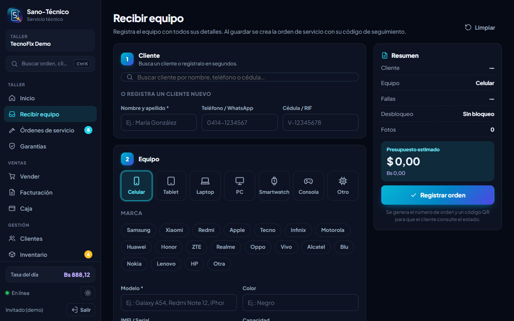
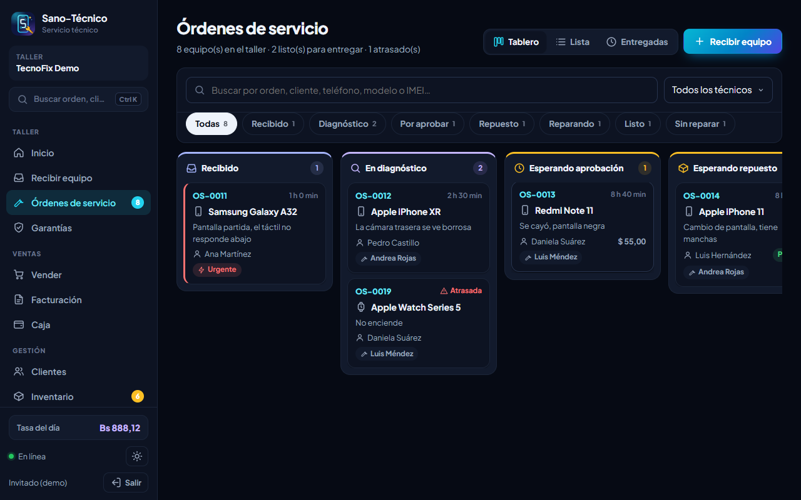
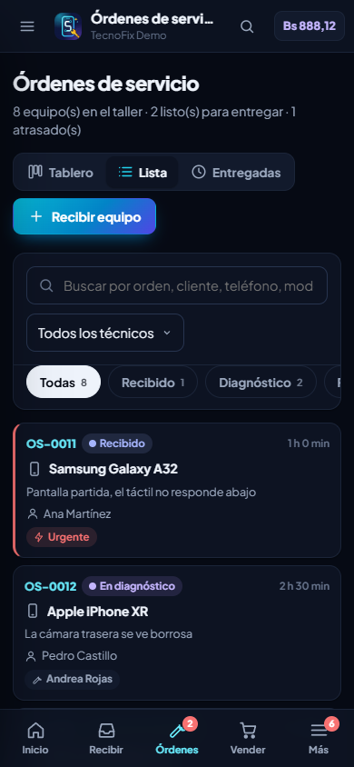
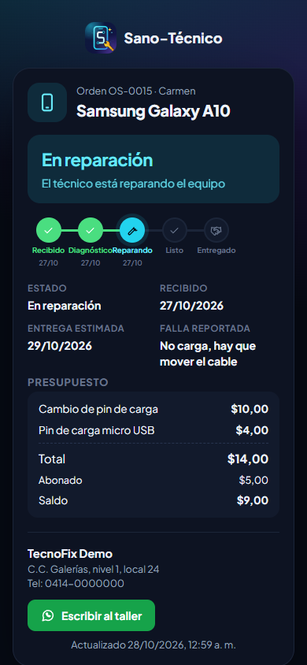
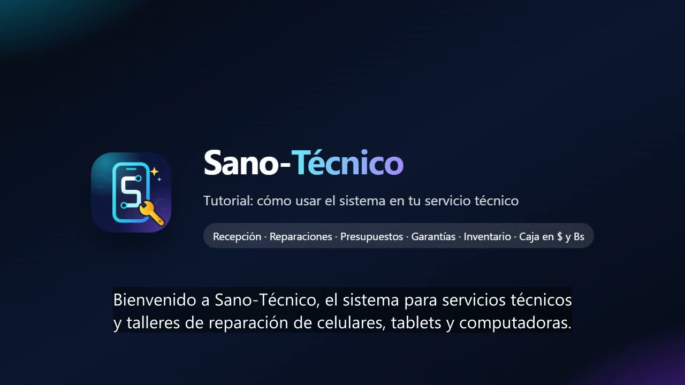

<div align="center">


# Sano-Técnico

### El sistema para servicios técnicos y talleres de reparación

Celulares · Tablets · Laptops · PC · Consolas · Smartwatch — recibe, repara, cobra y entrega con todo bajo control.

[](https://sano-tecnico.web.app)
[](https://wa.me/584221906045?text=Hola%2C%20quiero%20informaci%C3%B3n%20de%20Sano-T%C3%A9cnico)


**[sano-tecnico.web.app](https://sano-tecnico.web.app)**

</div>

---

<p align="center">
  
  &nbsp;
  
</p>

## ✨ ¿Qué es?

**Sano-Técnico** es un sistema web pensado para el día a día de un servicio técnico en Venezuela: desde que el cliente deja el equipo en el mostrador hasta que lo retira reparado, con factura y garantía. Trabaja en **dólares y bolívares** con la **tasa BCV** automática, funciona en cualquier dispositivo y se instala como app sin pasar por ninguna tienda.

> 💡 Toca **"Probar demo gratis"** en [sano-tecnico.web.app](https://sano-tecnico.web.app): tendrás 30 minutos con un taller de ejemplo lleno de órdenes, repuestos y ventas. El PIN de la demo es **1234**.

## 🛠️ Funciones

<table>
<tr>
<td width="50%" valign="top">

### 📥 Recepción del equipo en 5 pasos
- Cliente nuevo o existente
- Tipo, marca, modelo, color y capacidad
- **IMEI con validación** automática
- Clave, PIN o **patrón dibujado en pantalla** (protegido con el PIN del taller)
- Falla reportada y **revisión al recibir**: qué funciona, estado físico, accesorios y hasta 4 fotos
- Presupuesto, técnico, fecha de entrega, garantía y abono

</td>
<td width="50%" valign="top">

### 🧩 Tablero del taller
- Órdenes de servicio **OS-0001…** por etapas:
  `Recibido → Diagnóstico → Por aprobar → Esperando repuesto → Reparando → Listo → Entregado`
- Atrasadas en rojo y urgentes con etiqueta
- Vista de tablero, lista e historial exportable
- Búsqueda por número, cliente, teléfono, modelo o IMEI (**Ctrl + K**)

</td>
</tr>
<tr>
<td valign="top">

### 📋 Ficha de cada orden
- Presupuesto con servicios y **repuestos del inventario** (se descuentan solos)
- Abonos y entrega con cobro combinado: $, Bs, punto, pago móvil, Zelle…
- **Avisos por WhatsApp** con el mensaje ya escrito
- Impresión de la orden en carta (términos, firmas, QR y patrón), **ticket 80 mm** y **etiqueta** para el equipo

</td>
<td valign="top">

### 🔎 Consulta pública para el cliente
- El cliente escanea el **QR** o entra a `/estado/CÓDIGO`
- Ve la etapa de su equipo, el presupuesto y la garantía
- Botón directo para escribirle al taller
- Menos llamadas preguntando "¿ya está listo?"

</td>
</tr>
<tr>
<td valign="top">

### 💰 Ventas y caja
- **Venta de accesorios** en mostrador (forros, vidrios, cargadores)
- **Facturación**: notas de entrega, ventas y recibos de abono, con anulación protegida por PIN
- **Caja por turnos** en $ y Bs, gastos, ingresos y cierre con arqueo

</td>
<td valign="top">

### 📊 Gestión
- **Clientes** con historial de equipos y gasto
- **Inventario** con compras, costo promedio, mermas, conteo y lista de compras por WhatsApp
- **Técnicos** con comisión y rendimiento
- **Reportes**: ingresos, ganancia, fallas y marcas más comunes

</td>
</tr>
<tr>
<td valign="top">

### 🛡️ Garantías
- Equipos entregados con garantía vigente
- **Reingreso por garantía** en un clic, con todos los datos del equipo

</td>
<td valign="top">

### 🏢 Multisede
- Cada sede con sus datos **completamente aislados**
- Panel del administrador: crear, congelar, renovar y eliminar sedes
- Aviso general a todas las sedes

</td>
</tr>
</table>

## 📸 Capturas

<table>
<tr>
<td align="center"><br><sub><b>Recibir equipo</b></sub></td>
<td align="center"><br><sub><b>Tablero del taller</b></sub></td>
</tr>
</table>

<p align="center">
  
  
  
</p>

## 🎬 Video tutorial

<div align="center">

[](https://sano-tecnico.web.app/tutorial/sano-tecnico-tutorial.mp4)

*Recorrido narrado de casi 6 minutos por todo el sistema. También está dentro de la app, en **Ayuda y recorridos**, junto con guías paso a paso que señalan cada parte de la pantalla.*

</div>

## 📱 Instálalo en cualquier dispositivo

| Dispositivo | Cómo instalar |
|---|---|
| **Android** | Abre la web en Chrome y toca **Instalar app** |
| **iPhone / iPad** | En Safari toca **Compartir → Agregar a inicio** |
| **Windows / Mac** | En Chrome o Edge, toca el ícono de instalar en la barra de direcciones |

Se adapta a cualquier pantalla, desde un teléfono de 320 px hasta una PC, con tema claro y oscuro.

## ⚙️ Tecnología

- **Frontend:** JavaScript con módulos ES, sin compilación, y CSS propio
- **Backend:** Firebase Authentication, Cloud Firestore y Firebase Hosting
- **PWA:** service worker con funcionamiento sin conexión y manifest con accesos directos
- **Seguridad:** reglas de Firestore que aíslan cada sede (`tenants/{uid}`), bloquean sedes congeladas o vencidas, hacen caducar las demos y dejan las fichas públicas (`tracking/{código}`) solo para leer con el código exacto

```
SanoTecnico/
├── public/              # La app (se publica tal cual)
│   ├── js/              # main, store, ops, auth, tour, demo…
│   │   └── views/       # Inicio, Recibir, Órdenes, Caja, Reportes…
│   ├── css/app.css
│   ├── sw.js            # Service worker
│   └── manifest.webmanifest
├── firestore.rules      # Reglas de seguridad
├── firebase.json
└── scripts/             # Aprovisionamiento y pruebas automáticas
```

## 🧪 Pruebas

Cada cambio se prueba con un navegador real (Puppeteer + Chrome) sobre los emuladores de Firebase:

| Script | Qué verifica |
|---|---|
| `e2e.mjs` + `test-emu.sh` | Flujo completo de punta a punta: 56 pruebas (recepción, presupuesto, cobro, entrega, garantía, anulación, aislamiento entre sedes, reglas) |
| `mobile-check.mjs` | Que ninguna pantalla tenga scroll lateral en 7 tamaños, del teléfono a la PC |
| `prod-smoke.mjs` | Que producción funcione: demo, consulta pública, sedes y panel del administrador |
| `pwa-check.mjs` | Que la app se pueda instalar en PC y Android |
| `print-check.mjs` | Cómo salen los documentos impresos |

```sh
# Emuladores (auth 9199, firestore 8180, hosting 5066)
firebase emulators:start --only auth,firestore,hosting --project sano-tecnico
sh scripts/test-emu.sh

# Producción
firebase deploy --only auth,firestore,hosting --project sano-tecnico
node scripts/provision.mjs 20     # crea el admin y las sedes 01 a 20
```

## 📞 Contacto

<div align="center">

¿Quieres Sano-Técnico para tu taller?

[](https://wa.me/584221906045?text=Hola%2C%20quiero%20informaci%C3%B3n%20de%20Sano-T%C3%A9cnico)

También de la familia **Sano**: [Sano Gestión](https://sano-gestion.web.app) · [Sano Restaurant](https://sano-restaurant.web.app)

<sub>© 2026 Sano-Técnico · Todos los derechos reservados</sub>

</div>
